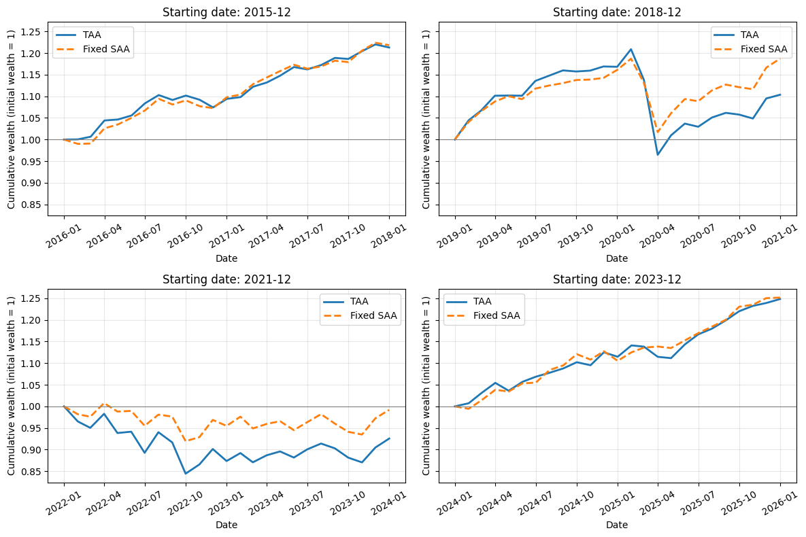
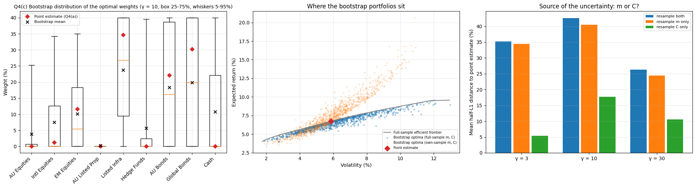

# Bloomberg multi-asset portfolio optimisation

**Can more frequent and more flexible allocation improve a pension portfolio?**

A quantitative finance research project using nine Bloomberg asset-class indices to construct
strategic portfolios, test monthly tactical allocation and evaluate a short-horizon dynamic policy.
The focus is the difference between solving an optimisation problem accurately and estimating
its inputs reliably.

[中文简介](README.zh-CN.md) · [Research notebook](notebooks/portfolio_research.ipynb) ·
[Report](docs/report.pdf) · [Presentation](docs/presentation.pdf) ·
[Aggregate results](results/)



## At a glance

| Item | Design |
|---|---|
| Setting | Australian superannuation / pension asset allocation |
| Data | Nine Bloomberg asset-class indices; 248 common monthly returns, Jan 2006-Aug 2026 |
| Investment universe | Equities, listed property, infrastructure, hedge funds, bonds and cash |
| Baseline constraints | Fully invested, long-only, maximum 40% per asset |
| Strategic portfolios | Minimum variance at 30%, 70% and 90% growth exposure |
| Historical evaluation | Four separate 120-month training / 24-month testing experiments |
| Dynamic extension | Three monthly periods, exponential utility, wealth-dependent policy |
| Tools | Python, pandas, NumPy, SciPy, Matplotlib, Jupyter |

## Research process

1. **Investigate the data.** Check missing observations, repeated index levels and effective
   update frequencies. Use monthly simple returns and desmooth hedge-fund estimation returns.
2. **Construct portfolios.** Estimate annual means/covariances, verify covariance validity,
   solve efficient frontiers and form growth/defensive strategic allocations.
3. **Separate numerical and estimation error.** Compare simulated utility optimisation with
   the deterministic mean-variance benchmark, then bootstrap whole monthly asset vectors.
4. **Test strategies out of sample.** Re-estimate within each training window, evaluate fixed
   SAA and monthly TAA, examine sensitivity, and charge drift-adjusted trading costs.
5. **Solve the dynamic extension.** Use Bellman backward induction, a 51-point wealth grid
   on [0.5, 1.5], 20,000 draws per date, CE interpolation and constrained optimisation.
   Validate against the final-period benchmark, refinement experiments and independent paths.



## Main findings

- **Estimation dominates solver error.** Monte Carlo allocation distance is approximately
  0.75% at the largest tested scenario count, versus a 42.6% average bootstrap allocation
  distance. These are distances between weights, not losses or probabilities of error.
- **Baseline TAA underperforms fixed balanced SAA in all four 24-month tests.** Higher turnover
  widens the shortfall after costs. Shorter windows or different risk aversion help in some
  tests, without producing a consistent advantage.
- **Dynamic allocation shows no detectable extra CE gain over a matched static utility
  portfolio in the December 2015 three-month model.** The estimate is -0.0097 bp of initial
  wealth with paired 95% MC interval [-0.0375, 0.0181]. Historical performance varies by period.
  This is not a claim that dynamic portfolios never beat fixed SAA.

The backtests and model-based comparison answer different questions. TAA versus SAA changes
the objective and growth mandate as well as parameter updating. The matched static control
holds the dynamic model inputs and feasible set fixed to examine the extra flexibility itself.

## My contribution and team attribution

This is a **seven-member team project**, not a sole-authored analysis. The notebook includes
collaborators' work on data, strategic construction, utility and historical evaluation.

**xihu0859's contribution:** participation in Python coding and evaluation for Q6 tactical
allocation, including sensitivity and turnover/cost analysis; numerical validation and strategy
comparisons for Extension B(d)-(e); corresponding report writing and presentation, including
the final summary. The README distinguishes these contributions from the complete team workflow.

## Run locally

```bash
python -m venv .venv
# Windows: .venv\Scripts\activate
# macOS/Linux: source .venv/bin/activate
python -m pip install -r requirements.txt
python scripts/check_notebook.py
python -m jupyterlab notebooks/portfolio_research.ipynb
```

**Data required for execution:** place an authorised workbook at `data/bloomberg.xlsx` or set
`BLOOMBERG_DATA_PATH`. See [data access and schema](data/README.md). The workbook is not published,
and no automatic download is included. Optional independent CVXPY checks use
`pip install -r requirements-optional.txt`.

Run notebook cells in order. The full Monte Carlo, bootstrap and repeated historical
optimisations are computationally heavier than the initial setup. The syntax checker does
not execute the notebook. Saved figures and aggregate tables make the study readable without
the proprietary data.

With authorised data available, `python scripts/run_selected_checks.py` re-executes selected
estimation, SAA/TAA and dynamic cells, including independent dynamic evaluation. It skips the
large Q4 repeated simulation/bootstrap experiments. See [validation scope](docs/validation.md).

## Repository guide

```text
notebooks/    Main research notebook with selected original chart outputs
figures/      Selected figures for the portfolio overview
results/      Aggregate TAA and dynamic comparison tables, with units/provenance
data/         Data-access instructions; raw workbook excluded
docs/         Team report and optional presentation
scripts/      Lightweight notebook validation
```

## Scope and limitations

The data span about twenty years, with four separate historical tests and a three-month
dynamic horizon. Mean estimates, dependence and regimes can change. Normal and iid models,
approximate desmoothing, whole-month bootstrap resampling and immediate month-end data
availability are simplifying assumptions. The study uses indices and does not model pension
liabilities, contributions, taxes or individual members. Results are academic experiments,
not a live investment product.

The archived course report is preserved as an original research artifact. Where its opening
summary is broad, use the qualified findings above: some dynamic historical returns exceed
SAA, while no clear extra utility gain appears against the matched static control.

## Background

- APRA (2021), *MySuper Heatmap: Methodology Paper*.
- Bellman (1957), *Dynamic Programming*.
- Efron (1979), *Bootstrap methods: another look at the jackknife*.
- The report contains the full methodological references.

Course context: FMAT3888, University of Sydney, 2026. Public portfolio edition prepared from
the team's research materials. Raw data, course instructions, duplicate drafts and private
download links are excluded.
